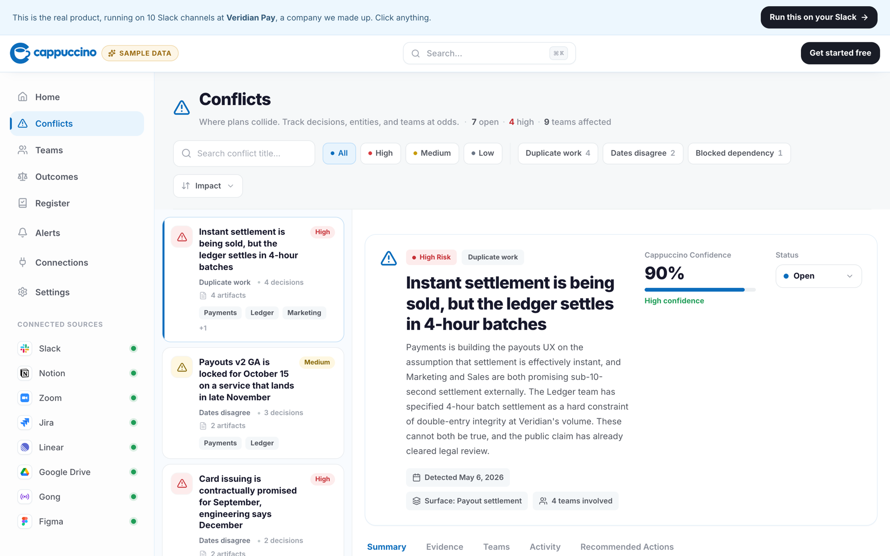
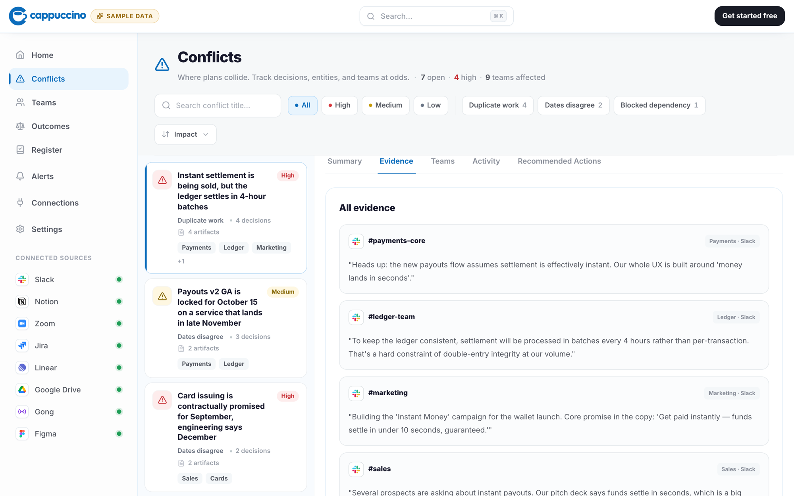
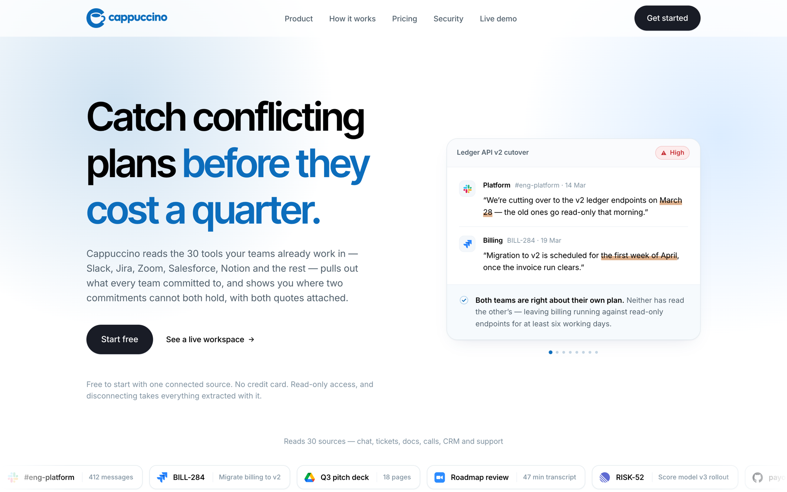
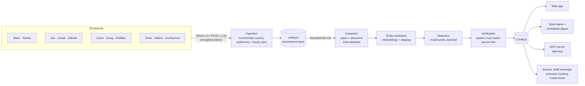

<p align="center">
  
</p>

<p align="center">
  <strong>Finds the places where two teams have quietly committed to incompatible things, before it becomes a missed launch.</strong>
</p>

<p align="center">
  <a href="https://usecappuccino.com">Live product</a> ·
  <a href="#architecture">Architecture</a> ·
  <a href="#code-tour">Code tour</a> ·
  <a href="#engineering-principles">Principles</a>
</p>

<p align="center">
  
  
  
  
  
  
</p>

---



## The problem

Sales tells a customer that card issuing ships in September. Engineering's Jira says December. Compliance is adding a KYC step that Mobile is removing that same sprint. Every one of those statements was made in public, in Slack, a ticket or a meeting, and nobody connected them until the launch slipped.

**Cappuccino reads where decisions actually get made, pulls out the commitments, and flags the ones that contradict each other.** Each finding comes with the exact quotes that prove it, the teams who need to talk, and a drafted message to get them talking.



<details>
<summary><strong>More: the landing page</strong></summary>
<br>



</details>

<sub>Screenshots are from the <a href="https://usecappuccino.com/demo">live demo</a>, which runs the real product on a fictional company's data.</sub>

## What I built

I built Cappuccino by myself, from the first commit to production: product, design, backend, AI pipeline, infrastructure and go-to-market site.

| | |
| --- | --- |
| **~105,000** lines of strict TypeScript | **1,290+** unit tests, plus a separate eval harness for the LLM work |
| **30** source integrations (Slack, Jira, GitHub, Zoom, Gong, Salesforce, Notion, Figma…) | **44** Postgres tables, with row-level security |
| **280+** commits since June 2026 | An **MCP server**, so coding agents can check a plan for conflicts before the PR exists |

**This repository is a curated slice.** The full codebase is private. What's here are self-contained modules chosen to show how I design, test and document production code. All of it is copied verbatim, and it builds and passes its tests on its own:

```bash
npm install
npm test          # 79 tests, no database, no network, no API keys
npm run typecheck
```

## Architecture



A few decisions that shaped it:

- **Two-pass AI, so a hallucination fails in code.** Detection is told to be exhaustive, which means it's sometimes wrong. A second pass has to *quote* the contradicting span from each side, and those quotes are string-matched against the text we actually hold. If the model invents a conflict, it has to invent a citation to go with it, and the citation won't match. The final check is code, not judgement.
- **The headline metric is false positives, not recall.** A detector that cries wolf gets muted and then uninstalled. The eval harness ([`evals/decisions/score.ts`](evals/decisions/score.ts)) plants *decoy* spans, proposals and hedges that look like decisions, and fails the build if precision drops below 0.80 or the decoy rate goes above 0.15.
- **Entity resolution is what makes detection work.** Three teams call the same thing "Payouts API v2", "payouts" and "the payouts flow". Unless those collapse to one surface, the contradictions between them can't be seen. Embeddings plus deterministic aliasing collapse them, and observations already resolved to one surface are marked as such for the detector.
- **Provenance everywhere.** Every extracted plan links back to the exact message, ticket or transcript line it came from. People don't act on an AI's claim. They act on a quote from their colleague.
- **Tenant sources only.** The product reads team channels, shared trackers and public support replies. It never reads personal drives or private notes. A draft isn't a commitment, so reading drafts would make the product *worse* as well as more invasive.

## Code tour

| Module | Why it's interesting |
| --- | --- |
| [`lib/mcp/protocol.ts`](lib/mcp/protocol.ts) | A stateless **Model Context Protocol** server written straight from the spec, with no SDK. Rejects requests whose routing headers disagree with the body, so a gateway can't authorise one call while the server runs another. [19 tests](tests/unit/mcp-protocol.test.ts). |
| [`lib/auth/totp.ts`](lib/auth/totp.ts) | RFC 6238 two-factor auth implemented rather than imported, and **proved against the RFC's published test vectors**. Uses a constant-time compare and a drift window. |
| [`lib/pkce.ts`](lib/pkce.ts) | RFC 7636 PKCE. The comments explain why the verifier is a secret, unlike `state`, and where that means it has to be stored. |
| [`lib/crypto.ts`](lib/crypto.ts) | AES-256-GCM for OAuth tokens at rest. Uses a versioned envelope (`v1:iv:tag:ct`), so the scheme can change without a flag day, and tampering fails loudly. |
| [`lib/concurrency.ts`](lib/concurrency.ts) | A 20-line bounded worker pool. It turned a 50-item sync from minutes to seconds without tripping provider rate limits, and keeps results in input order. |
| [`lib/sync/stream.ts`](lib/sync/stream.ts) | Streams progress for a five-minute sync as NDJSON. Errors go out as a final event, because the 200 status was sent minutes earlier. |
| [`evals/decisions/score.ts`](evals/decisions/score.ts) | LLM eval scoring kept separate from the model call, so **the gate itself is unit-tested**. A gate that computes the wrong number is worse than no gate. |
| [`lib/severity.ts`](lib/severity.ts) | One severity scale replacing five drifting palettes. WCAG AA contrast is verified, not eyeballed, and "low" is deliberately not green, because green means *resolved*. |
| [`excerpts/`](excerpts) | Database-bound code, here to be read: a `SELECT … FOR UPDATE` job slot with rerun coalescing, a serverless-safe Postgres rate limiter, at-most-once webhook dedupe, and schema-drift detection. |

## Engineering principles

You'll see these in the comments throughout:

1. **Comments explain *why*.** Each one names the alternative and what goes wrong with it. A reviewer shouldn't have to rediscover a decision to avoid undoing it.
2. **Failure modes are designed, not discovered.** If a sync runs cleanly and stores nothing, it looks exactly like a sync that worked. Code that could fail that way gets an explicit guard and a test.
3. **Prove it, don't trust it.** I use RFC test vectors for crypto, contrast ratios for colour, and an eval gate for prompts. When a check is cheap, it's code instead of a code-review comment.
4. **Make the compiler and the tests catch drift.** One registry declares every integration, and a test reads the SQL `CHECK` constraints back out of the schema and compares them to it. TypeScript can't see SQL, so a test has to.
5. **Tests never touch a real database or a real model.** Unit tests are pure and free. Model quality is measured by a separate, billable eval suite that runs before and after any prompt change.

## Stack

**App:** Next.js 16 (App Router, Server Components), React 19, Tailwind 4, TypeScript (strict)
**Data:** PostgreSQL (Supabase) with row-level security, embedding-based entity matching
**AI:** OpenAI GPT-4o for extraction, detection and verification; `text-embedding-3-small` for entity resolution; Zod-validated structured outputs
**Auth:** sessions with `jose`, bcrypt, TOTP 2FA with recovery codes, enterprise SSO (via SSOReady), SCIM provisioning
**Platform:** Vercel / AWS Amplify, GitHub Actions (CI, scheduled sync, weekly scheduled evals), Stripe billing, Resend email

## About

I'm **Justin Wagner**, a full-stack engineer who likes owning a product end to end: from the OAuth handshake to the eval metric to the empty-state copy.

I'm happy to walk through the full private codebase on a call.

📫 [justintwagner1@gmail.com](mailto:justintwagner1@gmail.com) · 🌐 [usecappuccino.com](https://usecappuccino.com)

---

<sub>© 2026 Justin Wagner. All rights reserved. This code is published for review only. See [LICENSE](LICENSE).</sub>
